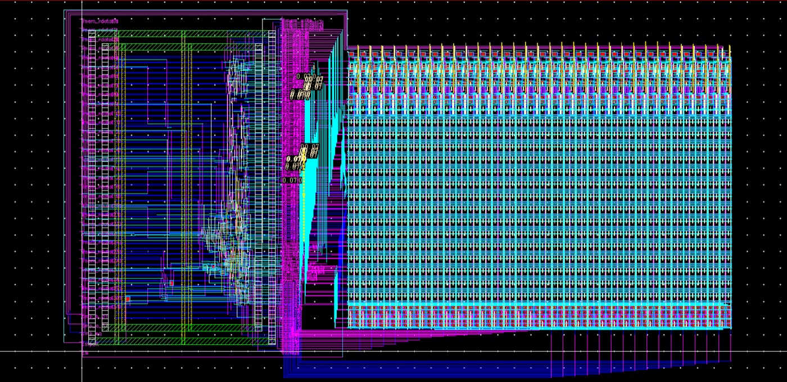

import LvsCorrect from "../../components/LvsCorrect.astro";

## Overview

Most processor projects stop at RTL, where tools turn your logic into gates you never see. Here, I drew every transistor of every gate myself in a 45 nm process, then worked up from single cells to a full CPU in three steps.

## 1. A standard-cell library

I designed and laid out 13 cells in Cadence Virtuoso: an inverter and buffer, NAND, NOR, AND, OR, AOI and OAI gates, XOR and XNOR, a 2-input mux, a D-latch, and a D flip-flop.

- **They tile together.** Every cell is 1.6 µm tall with the same power rails and wells, so any cell can sit next to any other in a row. Pins are on metal 2, and each cell has its own well taps.
- **Matched drive strength.** Transistors are sized so every cell's worst-case pull-up and pull-down are as strong as a minimum-size NMOS.
- **Compact.** Sharing source and drain regions keeps the cells small: the inverter is 0.38 × 1.6 µm and the flip-flop is 3.04 × 1.6 µm.
- **Verified.** Every cell passes DRC (design rules), LVS (layout matches the schematic), and functional simulation.

<LvsCorrect />

## 2. A hand-drawn datapath

Instead of laying out a 32-bit datapath directly, I designed a single 1-bit slice and stacked 32 copies of it. Each slice holds one bit of everything:

- a custom register file (write when the clock is low, read when it's high, with `x0` hardwired to 0), built from my own register bit cell
- the ALU, the branch comparator, and the PC adder
- a 6-input mux, and sign and zero extension for loads

The schematic matched the reference outputs in simulation, and the final layout passes DRC and LVS. I also built and simulated a shifter for the shift instructions as extra credit, but left it out of the final datapath.

## 3. Automated place-and-route

To let the automated tools build with my cells, I characterized them into the library files the tools read (`stdcells.lib` and `stdcells.lef`). From there:

- **Controller:** I synthesized the control unit and placed and routed it in Cadence Innovus with my cells. The Tcl script sets up the floorplan, power rings, a metal-6 power grid, and pin placement. Then I brought it back into Virtuoso and wired it to the hand-drawn datapath.
- **Full CPU from standard cells:** I placed and routed the entire processor using only my cell library.
- **Full CPU with a custom register file:** I characterized my register file as a hard macro (61.2 × 3.4 µm) and placed and routed the CPU around it. Getting this one clean took extra work: tight halos around the macros, running power routing after macro placement so the rails wouldn't cause DRC shorts, moving signal routing up to metal 2 and above, and high-effort congestion settings.

## Takeaways

With VLSI, I feel like I completed the stack. My undergrad was mostly software focused, so it was rewarding to finally see how RTL becomes real hardware: how logic gates actually work at the transistor level, and how every design choice comes down to physical details like transistor sizing, load, and routing.

It was also eye-opening to see how much work goes into building even a simple CPU this way, and to get hands-on with the modern place-and-route tools that real chips are built with.
